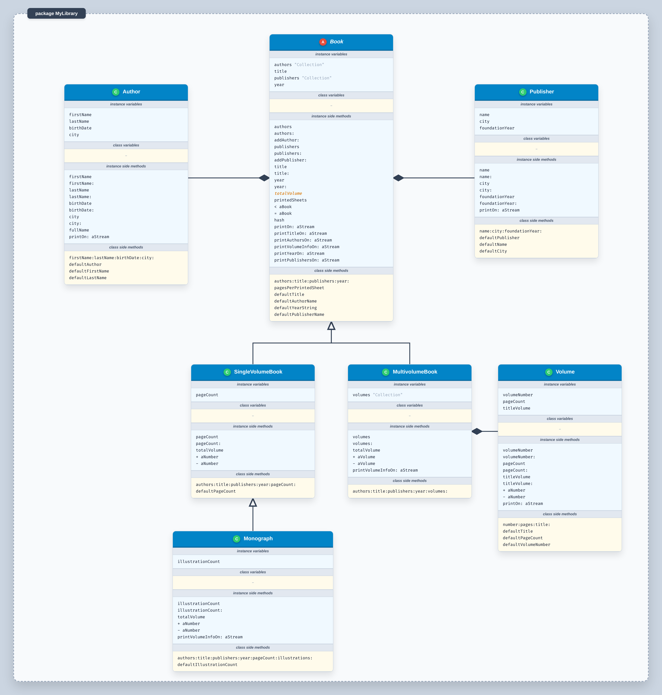

## Командне проектування класів мовою Pharo

Учасники:
- Кравчук Андрій (AndriiyKr) – капітан команди
- Туркевич Ірина (IrisLikeTheFlower)
- Федорчак Назарій (GrayTheCat)
- Палюх Олег (Kredle)

### Розподіл обов'язків

| Учасник команди | Задачі та зона відповідальності |
| :--- | :--- |
| **Андрій** | Створення ієрархії класів, розробка скелету ієрархії в браузері класів, реалізація базових класів `Book`, `Author`, `Publisher`. |
| **Ірина** | Допомога в створенні ієрархії, розробка однотомних видань (реалізація класів `SingleVolumeBook` та `Monograph`), а також написання тестів до них. |
| **Назар** | Розробка багатотомних видань (реалізація класів `MultiVolumeBook` та `Volume`), а також написання тестів до них. |
| **Олег** | Написання скрипта (створення 5 різних об’єктів, алгоритми обробки контейнера, збереження у файл), розробка інтерфейсу діалогу з користувачем. |

## Умова завдання:
### Початкове завдання
Спроектуйте класи, вказані нижче. У кожному з них визначте метод виведення в потік, методи порівняння, виконання арифметичних дій. Оголошення цих класів розташуйте у окремому пакеті. Інформацію про екземпляри класів задайте в Playground, прочитайте з клавіатури або з файлу. Функціонал класів перевірте за допомогою модульних тестів.
1. Сутність «книга» характеризується такими даними: автор, назва, видавництво, рік видання. Для повного опису «монографії» додатково потрібно пам’ятати кількість сторінок та кількість ілюстрацій (на окремій сторінці), для опису «багатотомного видання» – кількості томів і сторінок у кожному томі. Оголосіть класи, що моделюють описані сутності. Екземпляри цих класів вміють повідомляти автора, назву, рік, кількість друкованих аркушів. Кількість друкованих аркушів обчислюється як загальний обсяг книги, розділений на 32. Величину книг порівнюють за обсягом.
2. Створіть п’ять різних книг та занесіть їх у контейнер. Забезпечте можливість вводити в режимі діалогу інформацію про нову книгу і долучати її до колекції інших.Надрукуйте всі елементи контейнера. Знайдіть найбільшу за обсягом книгу. Чи це багатотомник? Продемонструйте використання арифметичних операторів. Створіть нову колекцію, що містить книги певного автора.
3. Продемонструйте зберігання створених об’єктів до файлу (до різних файлів у різних форматах), до бази даних (наявність бази можна імітувати в пам’яті) та завантаження їх з файлу, з бази. Робота з БД - завдання на майбутнє.
### Продовження завдання
У попередньому завданні ви створили пакет з ієрархією класів Книга, Монографія, Багатотомне видання. Доповніть пакет оголошенням класу Бібліотека (або Книжкова полиця: полиця зберігає по одному екземплярові, а бібліотека може мати по кілька однакових). Бібліотека має назву, зберігає колекцію книг, залучає нові та змінює застарілі на новіші видання; вміє виводити на друк інформацію про себе і свої книги (разом про всіх або про окрему категорію); вміє обчислювати загальну кількість примірників; знаходити книги певного автора, продукцію певного видавництва, книги певного року видання; повідомляти сумарну кількість друкованих аркушів. Іноді бібліотека запитує у власника, чи не потрібно вилучити/замінити книги давніх років. Ви можете доповнити функціонал бібліотеки на власний розсуд. Правильність роботи методів класу перевірте за допомогою модульних тестів.
Засобами Spec 2.0 побудуйте віконний інтерфейс для взаємодії з бібліотекою і книгами. Головне вікно мало б відображати інформацію про бібліотеку та наявні книги, надавати доступ через візуальні засоби (меню, кнопки тощо) до функціоналу бібліотеки. Для отримання від користувача інформації про нову книгу створіть власне вікно діалогу. Його вміст мав би залежати від типу книги. Забезпечте можливість зберігати бібліотеку до файлу (у різних форматах) та завантажувати її з файлу, зберігати до бази даних і завантажувати звідти. Щоб обрати ім’я файлу, використайте стандартний діалог.


## Діаграма класів


Спроєктована діаграма описує об'єктно-орієнтовану модель бібліотечної системи.

**Основні архітектурні особливості:**

* **Абстрактні базові класи (`Magnitude` та `Book`)**: Кореневим вузлом ієрархії виступає абстрактний клас `Magnitude`, від якого успадковується клас `Book`. `Book` інкапсулює загальні властивості будь-якої книги та містить абстрактні методи `totalVolume`, `+ anArgument` та `- anArgument` (на діаграмі виділені курсивом), реалізація яких делегується конкретним класам-нащадкам.
* **Відношення Композиції**:
  * Автори та видавництва винесені в окремі класи (`Author`, `Publisher`). Базовий клас `Book` містить колекції цих об'єктів (зв'язок "один-до-багатьох").
  * Багатотомне видання (`MultivolumeBook`) композиційно складається з колекції об'єктів `Volume` (Том), кожен з яких має власний номер, назву та кількість сторінок.
* **Відношення Успадкування**:
  * Клас `Book` розширює `Magnitude` для підтримки операцій порівняння.
  * `SingleVolumeBook` (Однотомник) та `MultivolumeBook` (Багатотомник) розширюють `Book`, розділяючи логіку роботи з обсягом книги.
  * `Monograph` (Монографія) успадковує `SingleVolumeBook` і додає властивість `illustrationCount`.
* **Поліморфізм та перевантаження операторів**: Оскільки арифметичні оператори оголошені як абстрактні в базовому класі, нащадки реалізують їх по-різному. Для однотомних видань і томів оператори `+ aNumber` та `- aNumber` модифікують кількість сторінок, тоді як для багатотомника оператори `+ aVolume` та `- aVolume` додають або видаляють цілі томи з колекції.

### Завантаження проєкту
Щоб завантажити проєкт собі до середовища, виконайте:
```
Metacello new
    baseline: 'MyLibrary';
    repository: 'github://AndriiyKr/pharo-book-project:book-code/src';
    load
```
