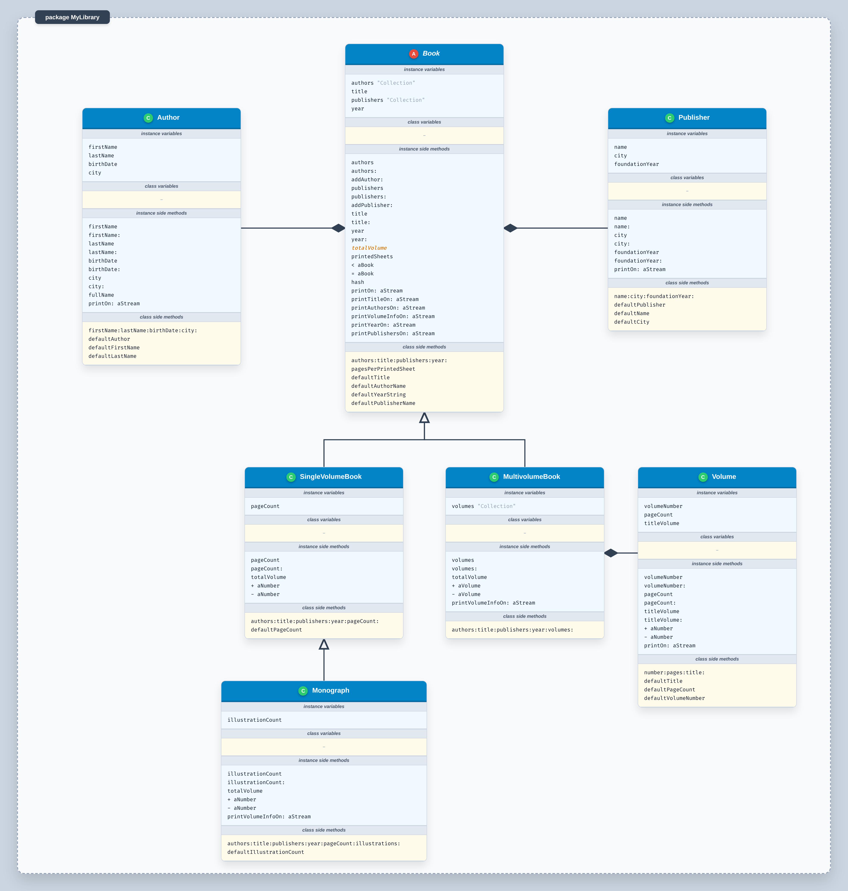

## Командне проектування класів мовою Pharo

Учасники:
- Кравчук Андрій – капітан команди
- Туркевич Ірина
- Федорчак Назарій
- Палюх Олег

## Умова завдання:

Спроектуйте класи, вказані нижче. У кожному з них визначте метод виведення в потік, методи порівняння, виконання арифметичних дій. Оголошення цих класів розташуйте у окремому пакеті. Інформацію про екземпляри класів задайте в Playground, прочитайте з клавіатури або з файлу. Функціонал класів перевірте за допомогою модульних тестів.
1. Сутність «книга» характеризується такими даними: автор, назва, видавництво, рік видання. Для повного опису «монографії» додатково потрібно пам’ятати кількість сторінок та кількість ілюстрацій (на окремій сторінці), для опису «багатотомного видання» – кількості томів і сторінок у кожному томі. Оголосіть класи, що моделюють описані сутності. Екземпляри цих класів вміють повідомляти автора, назву, рік, кількість друкованих аркушів. Кількість друкованих аркушів обчислюється як загальний обсяг книги, розділений на 32. Величину книг порівнюють за обсягом.
2. Створіть п’ять різних книг та занесіть їх у контейнер. Забезпечте можливість вводити в режимі діалогу інформацію про нову книгу і долучати її до колекції інших.Надрукуйте всі елементи контейнера. Знайдіть найбільшу за обсягом книгу. Чи це багатотомник? Продемонструйте використання арифметичних операторів. Створіть нову колекцію, що містить книги певного автора.
3. Продемонструйте зберігання створених об’єктів до файлу (до різних файлів у різних форматах), до бази даних (наявність бази можна імітувати в пам’яті) та завантаження їх з файлу, з бази. Робота з БД - завдання на майбутнє

## Діаграма класів

Спроектована діаграма описує об'єктно-орієнтовану модель бібліотечної системи. Архітектура базується на ключових принципах ООП: абстракції, поліморфізмі, успадкуванні та композиції.

**Основні архітектурні особливості:**

*   **Абстрактний базовий клас** (`Book`): Виступає кореневим вузлом ієрархії. Він інкапсулює загальні властивості будь-якої книги та містить абстрактний метод `totalVolume` (на діаграмі виділений курсивом), реалізація якого делегується конкретним класам-нащадкам.
*   **Відношення Композиції**: 
    *   Автори та видавництва винесені в окремі класи (`Author`, `Publisher`). Базовий клас `Book` містить колекції цих об'єктів (зв'язок "один-до-багатьох").
    *   Багатотомне видання (`MultivolumeBook`) композиційно складається з колекції об'єктів `Volume` (Том), кожен з яких має власний номер, назву та кількість сторінок.
*   **Відношення Успадкування**:
    *   `SingleVolumeBook` (Однотомник) та `MultivolumeBook` (Багатотомник) розширюють `Book`, розділяючи логіку роботи з обсягом книги.
    *   `Monograph` (Монографія) успадковує `SingleVolumeBook` і додає властивість `illustrationCount`.
*   **Поліморфізм та перевантаження операторів**: Для однотомних видань і томів оператори `+ aNumber` та `- aNumber` модифікують кількість сторінок, тоді як для багатотомника оператори `+ aVolume` та `- aVolume` додають або видаляють цілі томи з колекції.

